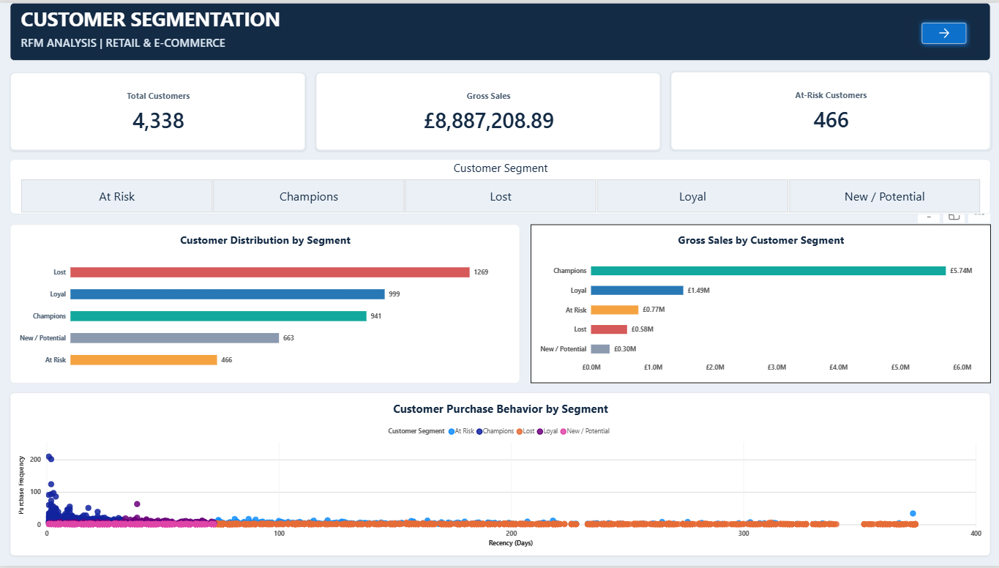
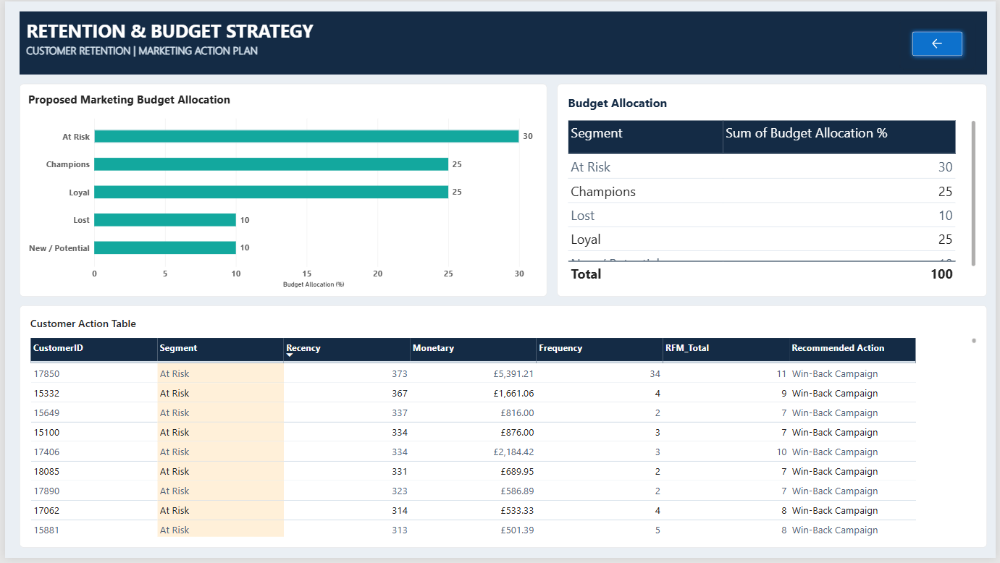

Customer Segmentation \& RFM Analysis | Python \& Power BI

Project Overview

This project analyzes retail transaction data to identify valuable
customers, understand purchasing behavior, and develop targeted customer
retention strategies using RFM (Recency, Frequency, Monetary)
Analysis.

The objective is to help marketing teams identify high-value customers,
prioritize at-risk customers, and make informed customer retention and
budget allocation decisions.

Business Problem

Which customer segments provide the greatest value to the business, and
how should marketing prioritize retention campaigns?

Tools \& Technologies

* Python
* Pandas and NumPy
* Jupyter Notebook
* Power BI
* DAX
* Microsoft Excel

Dataset
Source: UCI Online Retail Dataset

* Original transactions: 541,909
* Analysis period: December 2010 -- December 2011
* Unique customers after cleaning: 4,338

Data Cleaning \& Preparation

* Removed duplicate transactions.
* Removed records with missing Customer IDs.
* Excluded cancelled invoices.
* Removed transactions with invalid quantities or unit prices.
* Calculated transaction revenue using Quantity × UnitPrice.
* Prepared a clean dataset for customer-level analysis.

Final dataset: 392,692 transactions and 4,338 customers.

RFM Analysis

Customers were evaluated using:

* Recency: How recently a customer purchased.
* Frequency: How often a customer purchased.
* Monetary: How much a customer spent.

Customers received quintile-based RFM scores and were classified into
five segments.

      Customer Segment             Customers Recommended Strategy
        Champions                  941 VIP rewards and loyalty benefits
        Loyal                      999 Repeat purchase incentives
        At Risk                    466 Win-back campaigns
        New / Potential            663 Second-purchase offers
        Lost                       1,269 Low-cost reactivation

Power BI Dashboard

Page 1 --- Customer Segmentation

* Total customer overview
* Gross sales overview
* At-risk customer count
* Customer distribution by segment
* Gross sales by segment
* Customer purchase behavior scatter chart
* Interactive segment filtering

Page 2 --- Retention \& Budget Strategy

* Proposed marketing budget allocation
* Segment-level budget distribution
* Customer-level action table
* Recommended marketing actions
* Interactive page navigation

Proposed Marketing Budget Allocation

    Segment                                  Proposed Allocation(%)                                                                                                  
    At Risk                                            30%
    Champions                                          25%
    Loyal                                              25%
    New / Potential                                    10%
    Lost                                               10%
    Total                                              100%

Key Findings

* The analysis identified 4,338 customers across five RFM segments.
* Champions represent 941 customers and are a priority group for
loyalty and VIP strategies.
* At Risk customers represent 466 customers and are candidates for
targeted win-back campaigns.
* Lost customers form the largest segment, with 1,269 customers,
suggesting an opportunity to test low-cost reactivation strategies.
* New / Potential customers can be encouraged to make a second
purchase.

Business Recommendations

1. Retain Champions through exclusive rewards and personalized
experiences.
2. Encourage Loyal customers to increase repeat purchases.
3. Prioritize At Risk customers for win-back campaigns.
4. Convert New / Potential customers into repeat buyers.
5. Use cost-controlled reactivation campaigns for Lost customers.

Project Limitations

* The dataset does not contain actual marketing campaign expenditure
or campaign outcomes.
* Customer segmentation is based on historical purchasing behavior.
* Proposed budget allocation requires validation through controlled
marketing experiments.
* RFM segments represent analytical classifications, not guaranteed
future customer behavior.

Conclusion

This project demonstrates how Python-based data preparation, RFM
analysis, and Power BI visualization can transform retail transaction
data into actionable customer retention strategies and business
recommendations.

Repository Structure

Customer\_Segmentation\_RFM/

      ├── data/
      |  └── Online Retail.xlsx
      | 
      ├── notebooks/
      | └── Customer\_Segmentation\_RFM.ipynb
      |   
      ├── output/│             
      |      ├── customer\_rfm.csv
      |      ├── segment\_summary.csv
      |      └── cleaned\_transactions.csv
      |        
      |── powerbi
      | └── Retail\_Ecommerce\_Customer\_Segmentation\_RFM.pbix 
      ├── screenshots/   
      |   ├── customer\_segmentation.png 
      |   └── retention\_budget\_strategy.png
      |
      └── README.md
      
---

## Dashboard Screenshots

### Page 1 — Customer Segmentation

### Page 2 — Retention & Budget Strategy

